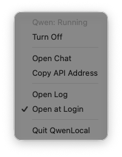

<div align="center">

# QwenLocal

**A tiny macOS menu bar switch for a local [llama.cpp](https://github.com/ggml-org/llama.cpp) server.**

See if your model is off, loading or running. Turn it on or off with one click.




</div>

## Why

A large local model eats most of your RAM. You want it running when you use it and gone
when you don't, without opening a terminal every time.

QwenLocal sits in the menu bar and does exactly that. Nothing more.

- **Manual only.** The model never starts on its own. Not when the app opens, not at login.
  Only when you click **Turn On**.
- **No colored dot.** The icon is a plain monochrome symbol. A green or red dot in the menu
  bar looks like a recording indicator when you share your screen.
- **No state of its own.** It asks launchd and the server every few seconds, so it always
  agrees with whatever you do in the terminal.

## The icon

| Icon | Meaning |
|---|---|
| `cpu` outline | Off |
| `cpu` outline, pulsing | Loading the model |
| `cpu` filled | Running and ready |
| `exclamationmark.triangle` | Still not ready after 5 minutes. Check the log. |

## The menu

- **Turn On / Turn Off** loads or unloads the launchd job.
- **Open Chat** opens the llama.cpp web UI at `http://127.0.0.1:8080/`.
- **Copy API Address** copies `http://127.0.0.1:8080/v1` (OpenAI-compatible).
- **Open Log** opens the server log in Console.
- **Open at Login** starts the app at login. Only the app, never the model.
- **Quit** closes the app. The model keeps running if it was on.

## Setup

### 1. Run llama-server as a launchd job

Save this as `~/.local/llama.cpp/mp.kaio.qwen.plist`, with your own paths and model.
Keep it **out of** `~/Library/LaunchAgents`, so macOS never starts it by itself.

```xml
<?xml version="1.0" encoding="UTF-8"?>
<!DOCTYPE plist PUBLIC "-//Apple//DTD PLIST 1.0//EN" "http://www.apple.com/DTDs/PropertyList-1.0.dtd">
<plist version="1.0">
<dict>
    <key>Label</key><string>mp.kaio.qwen</string>
    <key>ProgramArguments</key>
    <array>
        <string>/Users/YOU/.local/llama.cpp/build/bin/llama-server</string>
        <string>-m</string><string>/Users/YOU/models/your-model.gguf</string>
        <string>-ngl</string><string>99</string>
        <string>--host</string><string>127.0.0.1</string>
        <string>--port</string><string>8080</string>
    </array>
    <key>RunAtLoad</key><true/>
    <key>KeepAlive</key><true/>
    <key>StandardOutPath</key><string>/Users/YOU/Library/Logs/qwen-server.log</string>
    <key>StandardErrorPath</key><string>/Users/YOU/Library/Logs/qwen-server.log</string>
</dict>
</plist>
```

Want a different label, path or port? Change the constants at the top of
[`Sources/QwenLocal/Server.swift`](Sources/QwenLocal/Server.swift).

### 2. Install the app

```sh
git clone https://github.com/kaiomp/qwen_local.git
cd qwen_local
./scripts/install.sh
```

This builds a release, wraps it into `QwenLocal.app`, signs it locally, copies it to
`~/Applications` and opens it. Needs Xcode or the Swift 6 toolchain.

## How it works

| Question | How the app answers it |
|---|---|
| Is the job loaded? | `launchctl print gui/<uid>/mp.kaio.qwen` |
| Is the model ready? | `GET /health`: `200` ready, `503` still loading |
| Turn on | `launchctl bootstrap gui/<uid> <plist>` |
| Turn off | `launchctl bootout gui/<uid>/mp.kaio.qwen` |

It checks every 2 seconds while loading and every 5 seconds otherwise.

The same two `launchctl` commands work in a shell, so a terminal alias and the app can
drive the same job side by side.

## Develop

```sh
swift run QwenLocal   # run from source
swift test            # state logic tests
```

## License

[MIT](LICENSE)
